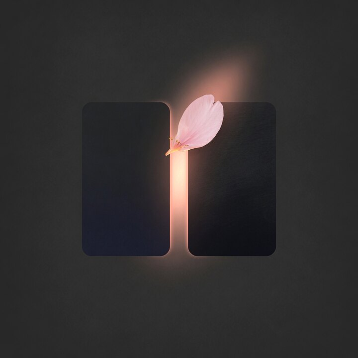
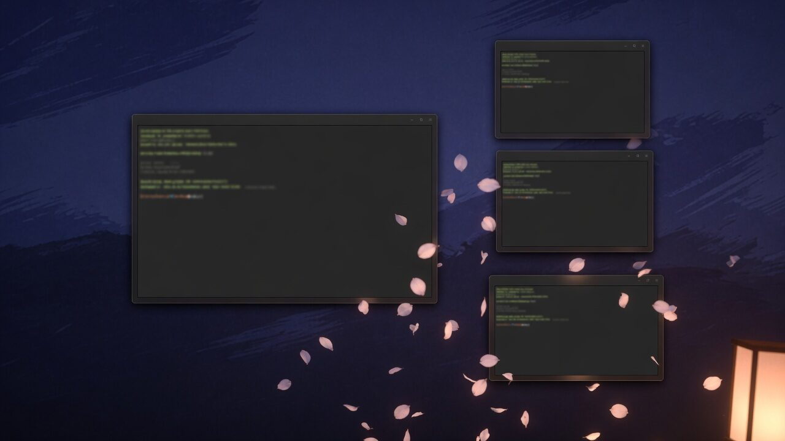
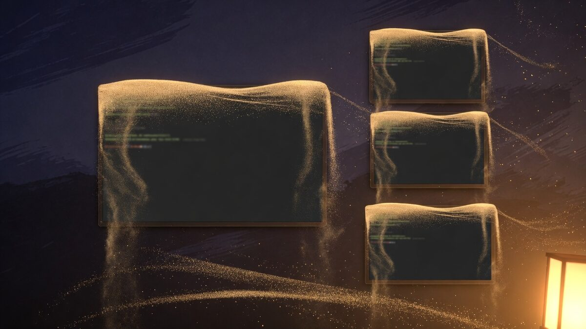
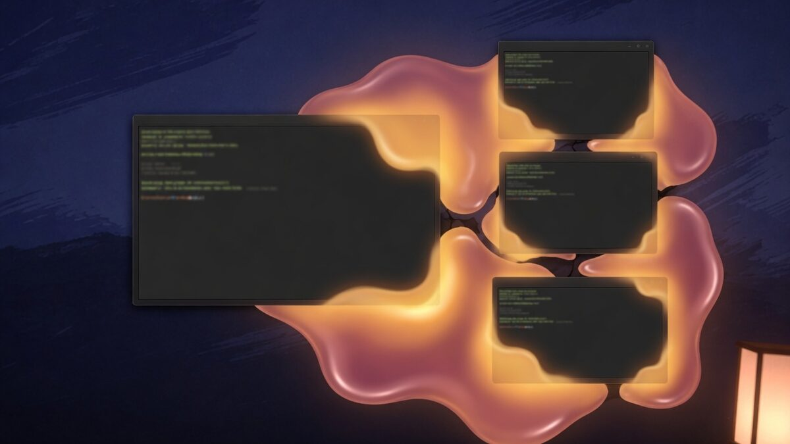

<p align="center">
  
</p>

<h1 align="center">Mawari</h1>

<p align="center">
  Motion in the empty space <strong>around and between</strong> Hyprland windows.<br>
  An <a href="https://omarchy.org/">Omarchy</a> shell plugin. The name is 周り: the space around something.
</p>

<p align="center">
  
  
  
</p>

<p align="center">
  
</p>

Mawari paints on the layer behind your windows, so titles, terminals, and the theme stay as they are. A chip on the bar cycles the effect. The desktop underneath keeps working.

Left-click the chip to move to the next effect. Right-click turns Mawari off.

## Install

```bash
omarchy plugin add https://github.com/toddvasquez/mawari.git --enable
```

Omarchy clones this repository to `~/.config/omarchy/plugins/toddv.mawari/` and places the chip in the right side of the bar. It asks before it adds anything. Pass `--yes` only when you already mean to skip that prompt.

To pick the section yourself, add it first, then enable it:

```bash
omarchy plugin add https://github.com/toddvasquez/mawari.git
omarchy plugin enable toddv.mawari --section right
```

`left` and `center` work the same way. Later:

```bash
omarchy plugin update toddv.mawari
```

Plugins run as unsandboxed code inside `omarchy-shell`. The interesting parts are `Service.qml`, `BarWidget.qml`, `MawariModel.js`, and `bin/flicker-frames.py`.

## Effects

The chip walks this order, then returns to cherry blossom:

`leaves` → `snow` → `sand` → `lava` → `flicker` → `off`

<table>
  <tr>
    <td width="50%" align="center" valign="top">
      
      <br>
      <strong>Cherry blossom</strong>
      <br>
      Petals tumbling in a gust, bouncing along window edges
    </td>
    <td width="50%" align="center" valign="top">
      
      <br>
      <strong>Snow</strong>
      <br>
      Quiet flakes in the margins and gaps
    </td>
  </tr>
  <tr>
    <td width="50%" align="center" valign="top">
      
      <br>
      <strong>Sand</strong>
      <br>
      Grains blown by wind, catching on the tops of windows and sliding around the sides
    </td>
    <td width="50%" align="center" valign="top">
      
      <br>
      <strong>Lava lamp</strong>
      <br>
      Warm glowing fluid pooling in the cracks between windows
    </td>
  </tr>
  <tr>
    <td colspan="2" align="center">
      
      <br>
      <strong>Flicker</strong>
      <br>
      On a dark theme, the brighter parts of the desktop picture waver like candlelight
    </td>
  </tr>
</table>

Particle effects read live window geometry from Hyprland and stay in the gaps. Fullscreen windows are left alone. Motion waits while the lock screen or the screensaver is up.

## Settings

On the bar entry, or on the `plugins[]` entry, in `~/.config/omarchy/shell.json`:

```json
{
  "id": "toddv.mawari",
  "effect": "leaves",
  "density": 1,
  "wind": 1
}
```

`effect` is `leaves`, `snow`, `sand`, `lava`, `flicker`, or `off`.

These names are accepted too: `blossom`, `petals`, `leaf`, `flake`, `snowing`, `dust`, `wind`, `fluid`, `lamp`, `goo`, and `candle`.

`density` runs from 0.35 to 2. `wind` runs from 0 to 2.5. Both apply to the particle effects. Flicker ignores them.

## Flicker

Flicker is for dark themes. On a light theme it can stay selected, and the picture stays still.

While it is on, Mawari copies the current desktop picture into a directory under `~/.local/state/omarchy/mawari/flicker/`. Each copy is the same picture with a different candle-light profile. Only pixels whose contrast ratio to the darkest elements of the picture is at least 3:1 are re-lit. Dark areas are copied unchanged. Mawari then cycles those pictures behind the windows.

Turning flicker on lists that directory first. If the pictures are already there, they are reused and nothing is copied again. A different picture, or the same file saved again, gets its own directory.

Building the frames needs `python3` and ImageMagick 7 (`magick` on your `PATH`). The other effects do not.

## Remove

```bash
omarchy plugin remove toddv.mawari --yes
```

Frame caches under `~/.local/state/omarchy/mawari/flicker/` are left in place. Delete that directory when you want the disk space back.

## Develop

From a checkout of this repo:

```bash
omarchy plugin validate .
node test/model.test.js
```

`omarchy plugin validate` checks `manifest.json`. The test covers the effect model and the flicker frame builder. The frame builder's self-test needs `python3` and `magick`. The live probe at the end of the test reads your current Omarchy desktop picture.

## License

[MIT](LICENSE)
